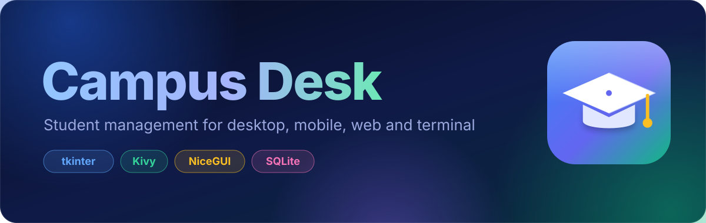
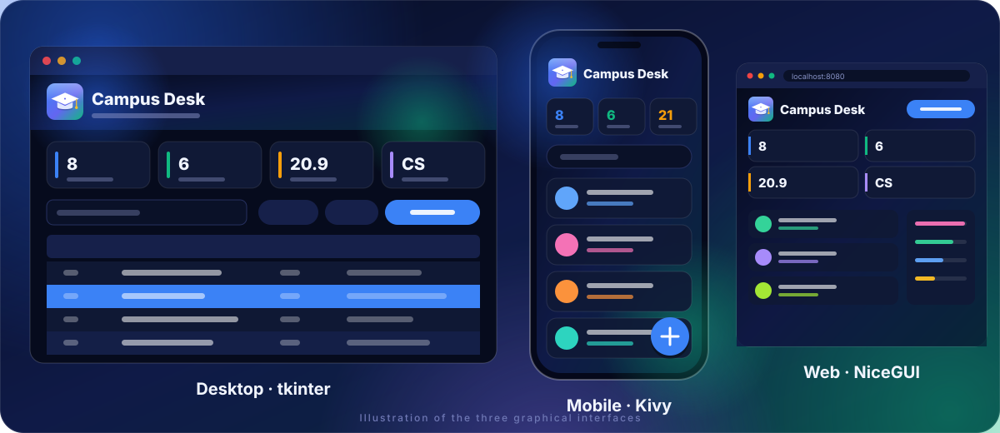
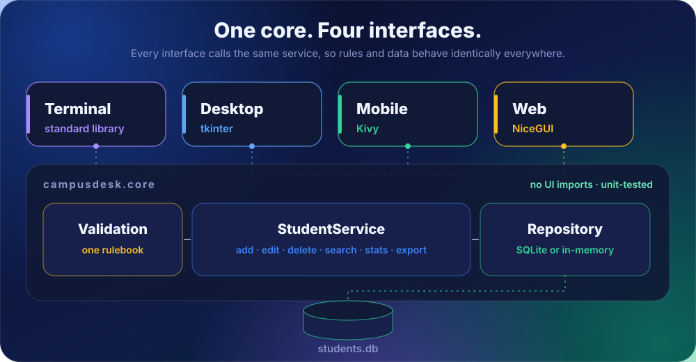

<div align="center">



**A student management system you can run on the desktop, on a phone, in a browser, or in a terminal.**
One shared core, four interfaces, one SQLite database.


</div>

---



## Features

- **Add, edit and delete students** (name, age, course) with friendly validation and a confirmation before deleting
- **Instant search** by name, course or ID, and **sorting** by ID, name, age or course
- **Live statistics:** total students, number of courses, average age and the most popular course
- **Export to CSV** from every graphical interface
- **Persistent storage** in a local SQLite database, so your records survive restarts
- **Consistent look:** one dark, glassy theme with colour-coded courses and avatars across all interfaces
- **Import your old data** from the original `students.json` (see [Data](#data-and-storage))

## Choose your interface

| Interface | Built with | Run it | Highlights |
| --- | --- | --- | --- |
| **Desktop** | `tkinter` + `ttk` | `python run.py` | Animated aurora header, sortable table, keyboard shortcuts, native file dialogs |
| **Mobile** | `Kivy` | `python run.py mobile` | Touch-first layout, full-screen form, floating **+** button, Android back-button support |
| **Web** | `NiceGUI` | `python run.py web` | Responsive dashboard, live course chart, works on phones and laptops |
| **Terminal** | standard library | `python run.py terminal` | Menu-driven, zero dependencies |

> The mobile interface opens in a phone-shaped window when run on a computer, so you can preview it before building the Android app.

## Quick start

```bash
git clone https://github.com/active-X1/Student-Management-System.git
cd Student-Management-System

python run.py --demo              # desktop app, with sample students on first run
```

The terminal and desktop interfaces need nothing beyond Python. For the other two:

```bash
pip install nicegui               # web interface
pip install kivy                  # mobile interface
# or both at once:
pip install -r requirements.txt
```

> **Linux:** if tkinter is missing, install it with `sudo apt install python3-tk`.
> If an interface's library isn't installed, Campus Desk tells you what to install and opens the terminal interface instead.

### Launcher options

| Command | What it does |
| --- | --- |
| `python run.py [desktop\|mobile\|web\|terminal]` | Pick an interface (default: desktop) |
| `--demo` | Add sample students when the database is empty |
| `--db PATH` | Use a specific database file |
| `--import-json FILE` | Import students from an old `students.json` first |
| `--port 9000` | Web port (default 8080) |
| `--no-browser` | Web: don't open a browser tab automatically |

Prefer an installed command? `pip install ".[all]"` adds `campus-desk`, for example `campus-desk web --demo`.

## Keyboard shortcuts (desktop)

| Keys | Action |
| --- | --- |
| `Ctrl+N` | Add a student |
| `Ctrl+F` | Focus the search box |
| `Esc` | Clear the search |
| `Enter` or double-click | Edit the selected student |
| `Delete` | Delete the selected student (asks first) |
| `Ctrl+E` | Export to CSV |

## Build the Android app

The mobile interface is built with [Buildozer](https://github.com/kivy/buildozer), and a ready-made `buildozer.spec` is included.
Buildozer runs on Linux (or WSL on Windows, or macOS).

```bash
pip install buildozer
buildozer android debug           # the first build downloads the Android toolchain and takes a while
buildozer android deploy run      # install on a connected phone
```

The APK is written to `bin/`. On a phone the database is stored in the app's private storage.

## Architecture



The golden rule: **`core` never imports an interface.** Validation, storage, search, statistics and export live in one place, are unit-tested without any GUI, and behave identically everywhere.

## Project structure

```text
.
├── src/
│   └── campusdesk/
│       ├── core/                  # pure logic, no UI imports
│       │   ├── models.py          # Student, Stats
│       │   ├── validation.py      # one rulebook for every interface
│       │   ├── repository.py      # SqliteRepository and MemoryRepository
│       │   ├── service.py         # StudentService: CRUD, search, stats, CSV
│       │   ├── paths.py           # where the database lives on each OS
│       │   └── demo.py            # sample data for --demo
│       ├── interfaces/
│       │   ├── terminal/          # menu-driven CLI
│       │   ├── desktop/           # tkinter app, dialogs and custom widgets
│       │   ├── mobile/            # Kivy screens and widgets
│       │   └── web/               # NiceGUI page and stylesheet
│       ├── assets/                # logo (SVG) and app icons (PNG)
│       ├── theme.py               # shared colours and gradient helpers
│       ├── launcher.py            # command-line entry point
│       └── resources.py, formatting.py
├── tests/                         # unit tests for core, terminal and launcher
├── docs/images/                   # README images
├── legacy/                        # the original procedural and OOP versions
├── main.py                        # Android entry point (Buildozer)
├── run.py                         # launcher that needs no installation
├── buildozer.spec
├── pyproject.toml
├── requirements.txt
└── LICENSE
```

## Data and storage

| Platform | Database location |
| --- | --- |
| Windows | `%APPDATA%\CampusDesk\students.db` |
| macOS | `~/Library/Application Support/CampusDesk/students.db` |
| Linux | `~/.local/share/CampusDesk/students.db` |
| Android | the app's private storage |

Set the `CAMPUSDESK_DB` environment variable (or pass `--db`) to use another file.

**Coming from the first version?** Your old `students.json` can be imported once:

```bash
python run.py --import-json students.json
```

Records that don't pass validation are skipped.

## Tech stack

| Technology | Used for |
| --- | --- |
| **Python 3.10+** | The whole application |
| **tkinter / ttk** | Desktop interface: canvas-drawn widgets, styled `Treeview`, dialogs |
| **Kivy** | Mobile interface: screens, touch widgets, Android packaging via Buildozer |
| **NiceGUI** | Web interface: reactive dashboard (FastAPI powers the CSV download route) |
| `sqlite3` | Persistent storage |
| `dataclasses`, `abc` | Models and the repository interface |
| `argparse` | The command-line launcher |
| `csv`, `json` | Export, and import of the legacy file |
| `unittest` | Test suite (`pytest` also works) |

## Development

```bash
pip install -r requirements-dev.txt
python -m unittest discover -s tests -v      # or: pytest
```

The tests cover validation, both storage back ends, search, sorting, statistics, CSV export, legacy import, the terminal interface and the launcher. They need no GUI library, so they run anywhere.

## Roadmap

- [ ] Real screenshots in this README
- [ ] Per-student grades and attendance
- [ ] Import from CSV
- [ ] Light theme

## History

Campus Desk grew out of a beginner project. The original single-file versions are preserved in [`legacy/`](legacy/).

## License

Released under the [MIT License](LICENSE). Built by [Cyrus Akacha Cyprian](https://github.com/active-X1).
